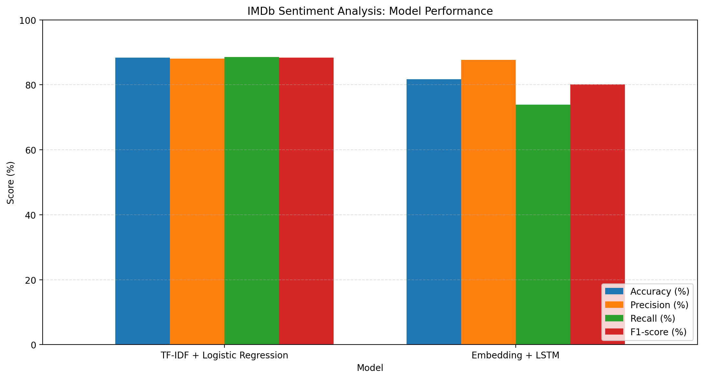

# IMDb Sentiment Analysis: Machine Learning vs Deep Learning

A comparative Natural Language Processing (NLP) project that classifies IMDb movie reviews as **Positive** or **Negative** using two different approaches:

- **Machine Learning:** TF-IDF + Logistic Regression
- **Deep Learning:** PyTorch + LSTM

The project includes separate implementations, saved model artifacts, prediction scripts, training notebooks, and a model comparison workflow.

## Overview

Sentiment analysis is an NLP task that identifies the emotional tone expressed in text. This project explores how a traditional machine learning pipeline compares with a neural sequence model on the IMDb movie review dataset.

**Dataset:** [stanfordnlp/imdb on Hugging Face](https://huggingface.co/datasets/stanfordnlp/imdb)

The dataset provides 25,000 training reviews and 25,000 test reviews, with balanced positive and negative classes.

## Project Structure

```text
imdb-sentiment-analysis/
├── machine-learning/
│   ├── models/
│   │   └── sentiment_model.joblib
│   ├── src/
│   │   ├── load_data.py
│   │   ├── predict.py
│   │   └── train_model.py
│   ├── README.md
│   └── requirements.txt
│   ├── .gitignore
├── deep-learning/
│   ├── models/
│   │   ├── sentiment_lstm.pth
│   │   └── vocab.json
│   ├── notebooks/
│   │   └── 01_imdb_sentiment_analysis.ipynb
│   ├── src/
│   │   ├── __init__.py
│   │   ├── load_data.py
│   │   ├── model.py
│   │   ├── predict.py
│   │   └── preprocess.py
│   ├── README.md
│   └── requirements.txt
│   ├── .gitignore
├── comparison/
│   ├── README.md
│   ├── model_comparison.ipynb
│   └── model_performance.png
├── .gitignore
├── requirements.txt
└── README.md
```

## Approaches

### 1. Machine Learning

The machine learning implementation uses a scikit-learn pipeline:

- **TF-IDF:** Converts review text into numerical features using unigrams and bigrams.
- **Logistic Regression:** Classifies the resulting feature vectors.
- **Joblib:** Saves the fitted pipeline for inference without retraining.

Key configuration:

| Parameter | Value |
|---|---|
| Maximum TF-IDF features | 20,000 |
| N-gram range | `(1, 2)` |
| Classifier | Logistic Regression |
| Maximum iterations | 1,000 |
| Random state | 42 |

See [machine-learning/README.md](machine-learning/README.md) for implementation and usage details.

### 2. Deep Learning

The deep learning implementation uses a PyTorch LSTM model:

- **Embedding layer:** Maps tokens to 100-dimensional vectors.
- **LSTM layer:** Processes review sequences with a hidden size of 64.
- **Packed sequences:** Handles variable-length reviews without treating padding tokens as meaningful input.
- **Linear classifier:** Produces scores for the two sentiment classes.

The vocabulary contains 30,000 tokens, and reviews are padded or truncated to a maximum length of 300 tokens. The trained weights and vocabulary are saved separately.

See [deep-learning/README.md](deep-learning/README.md) for implementation and usage details.

## Model Comparison

Both saved models were evaluated on the same 25,000 IMDb test reviews using their respective preprocessing pipelines. Neither model was retrained during the comparison.

| Metric | TF-IDF + Logistic Regression | Embedding + LSTM |
|---|---:|---:|
| Accuracy | **88.32%** | 81.74% |
| Precision (positive class) | **88.11%** | 87.67% |
| Recall (positive class) | **88.61%** | 73.88% |
| F1-score (positive class) | **88.36%** | 80.19% |
| Inference time (25,000 reviews) | **4.707 s** | 49.676 s |
| Average latency per review | **0.188 ms** | 1.987 ms |
| Required artifact size (MiB) | **0.887 MB** | 12.120 MB |

Inference times are from a single recorded run and are indicative, not definitive benchmarks. They include preprocessing and prediction as implemented in the comparison notebook. Timing can vary with hardware, batch size, and software environment.

The LSTM inference run used CUDA acceleration, while the scikit-learn pipeline ran on CPU. Therefore, these timings are environment-specific and should not be interpreted as a hardware-controlled speed comparison.

### Performance Visualization



The complete methodology, confusion matrices, results, and discussion are available in the [comparison README](comparison/README.md) and [comparison notebook](comparison/model_comparison.ipynb).

### Key Findings

- TF-IDF + Logistic Regression achieved higher accuracy, recall, and F1-score in this experiment.
- The LSTM achieved similar precision for the positive class, but its positive-class recall was lower.
- The recorded Logistic Regression pipeline was faster and required smaller saved artifacts in this run.
- These findings apply to the model configurations and evaluation procedure used here; they do not show that traditional machine learning is universally better than deep learning.

## Installation

### Prerequisites

- Python
- pip
- Internet access for the initial dataset download

Clone the repository:

```bash
git clone https://github.com/aidinpho/imdb-sentiment-analysis.git
cd imdb-sentiment-analysis
```

It is recommended to use a separate virtual environment for each implementation.

### Machine Learning

From the repository root, install the dependencies:

```bash
pip install -r machine-learning/requirements.txt
```

### Deep Learning

From the repository root, install the dependencies:

```bash
pip install -r deep-learning/requirements.txt
```

**PyTorch note:** The appropriate PyTorch installation depends on your operating system and whether you intend to use a CPU or a compatible CUDA-enabled GPU. Refer to the [official PyTorch installation selector](https://pytorch.org/get-started/locally/).

## Usage

Run commands from the repository root.

### Machine Learning

Train the model:

```bash
python machine-learning/src/train_model.py
```

Predict the sentiment of a review using the saved pipeline:

```bash
python machine-learning/src/predict.py
```

### Deep Learning

Predict the sentiment of a review using the saved LSTM weights and vocabulary:

```bash
python deep-learning/src/predict.py
```

For the deep learning training and evaluation workflow, see [deep-learning/notebooks/01_imdb_sentiment_analysis.ipynb](deep-learning/notebooks/01_imdb_sentiment_analysis.ipynb).

## Limitations

- Both models perform binary sentiment classification.
- TF-IDF does not fully capture word order or complex contextual relationships.
- LSTM predictions can be affected by vocabulary coverage, sequence length, and preprocessing choices.
- Inference timings are based on single recorded runs and should not be treated as rigorous benchmarks.
- Performance on other datasets may differ from the reported IMDb results.

## Future Improvements

- Add automated tests for preprocessing and inference.
- Run repeated, controlled inference benchmarks.
- Compare additional traditional and neural architectures.
- Document software versions, random seeds, and full environment details for improved reproducibility.

## License

No license has been specified yet. Add a `LICENSE` file if you intend to distribute the project under an explicit open-source license.